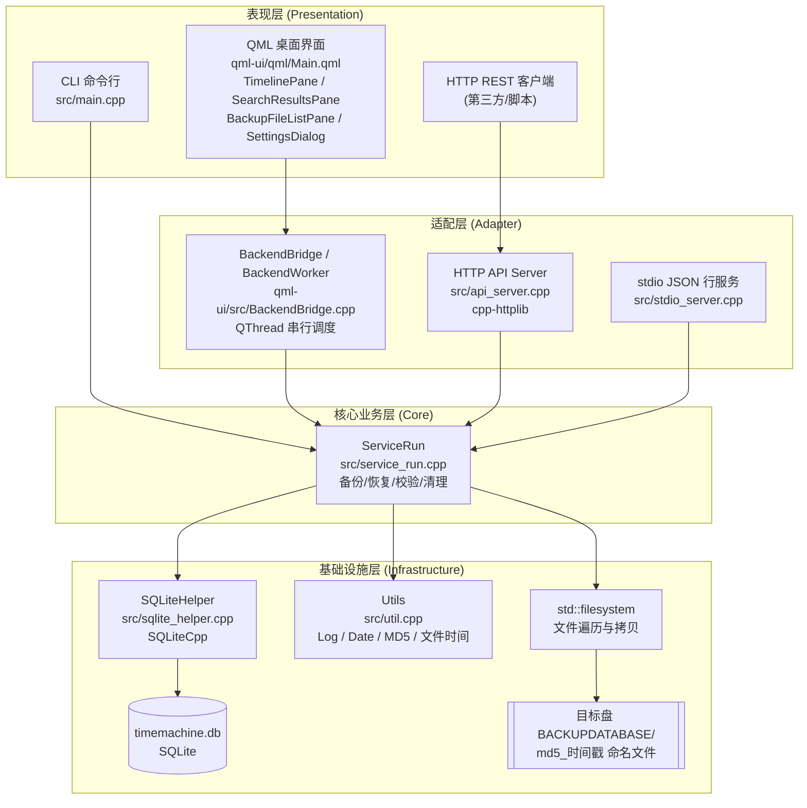

# Time Machine+ (C++) 项目技术文档

> 版本：1.0
> 适用代码库：`timemachineplus_cpp`（C++17 移植版）
> 文档面向：需要完成环境搭建、编译打包、运行与二次开发的技术人员

---

## 目录

1. [项目架构说明](#1-项目架构说明)
2. [技术栈清单](#2-技术栈清单)
3. [编译打包方法](#3-编译打包方法)
4. [使用方法](#4-使用方法)
5. [附录](#5-附录)

---

## 1. 项目架构说明

### 1.1 项目定位

Time Machine+ 是 macOS Time Machine 的开源复刻实现：把指定「备份源目录」中的文件增量式地归档到「备份目标目录」，并通过数据库记录每个文件的历史版本，支持按文件路径恢复、按备份 ID 清理、完整性校验。

C++ 版本由原 Java 项目迁移而来，核心目标是：

- 提供**命令行（CLI）**与**桌面 GUI（QML）**两种使用形态；
- 支持**多备份源**与**多备份目标**（分布式存储，按剩余空间自动选盘）；
- 保持数据格式与数据库 schema 简单可移植（SQLite 单文件）。

### 1.2 整体架构



### 1.3 模块划分与核心组件职责

| 层级 | 模块 / 文件 | 职责 |
|------|------------|------|
| 表现层 | [qml-ui/qml/Main.qml](../qml-ui/qml/Main.qml) | 主窗口：顶栏（搜索/健康状态/设置）、时间轴、内容区；响应式断点 860px |
| 表现层 | [qml-ui/qml/components/](../qml-ui/qml/components) | `TimelinePane`（备份时间轴）、`BackupFileListPane`（文件列表）、`SearchResultsPane`（搜索）、`SettingsDialog`（源/目标配置）、`AppButton`、`ConfirmDialog`、`AppSpinner`、`SettingsSection` |
| 表现层 | [qml-ui/qml/Theme.qml](../qml-ui/qml/Theme.qml) | 单例主题：颜色、字号、圆角、间距集中定义 |
| 表现层 | [src/main.cpp](../src/main.cpp) | CLI 入口：命令解析与分发 |
| 适配层 | [qml-ui/src/BackendBridge.h](../qml-ui/src/BackendBridge.h) | QML ↔ C++ 桥接。`BackendWorker` 在独立 `QThread` 中持有 `ServiceRun`，槽函数串行执行；`BackendBridge` 在主线程暴露 `Q_INVOKABLE` 并转发信号 |
| 适配层 | [src/api_server.cpp](../src/api_server.cpp) | HTTP REST API（cpp-httplib），默认端口 8765，绑定 `127.0.0.1`；所有请求串行化（内部互斥） |
| 适配层 | [src/stdio_server.cpp](../src/stdio_server.cpp) | stdin/stdout JSON 行协议（`--stdio`），用于子进程/编辑器集成 |
| 核心业务 | [src/service_run.cpp](../src/service_run.cpp) | 备份引擎：加载源/目标、文件遍历、MD5、目标选盘、拷贝、事务提交；恢复、删除、校验、清理 |
| 核心业务 | [include/service_run.h](../include/service_run.h) | `ServiceRun` 接口定义；DB 路径支持 `TIMEMACHINE_DB` 环境变量覆盖 |
| 基础设施 | [src/sqlite_helper.cpp](../src/sqlite_helper.cpp) | SQLite 打开/执行脚本/预编译语句封装，异常转为 `false` 返回值 |
| 基础设施 | [src/util.cpp](../src/util.cpp) / [include/util.h](../include/util.h) | `Utils::Log`（控制台+文件双写、线程安全）、`Utils::Date`、MD5、文件系统时间戳转换 |
| 配置 | [include/config.h](../include/config.h) | 常量：DB 名、日志名、schema 名、备份目录名、批量大小 |
| 配置 | [timemachine.sql](../timemachine.sql) | 数据库 schema（幂等 `IF NOT EXISTS`） |

### 1.4 数据模型（SQLite Schema）

数据库文件默认 `timemachine.db`，schema 见 [timemachine.sql](../timemachine.sql)：

| 表 | 字段 | 说明 |
|----|------|------|
| `tb_backuproot` | `id`, `rootpath` | 备份**源**根目录列表 |
| `tb_backuptargetroot` | `id`, `targetrootpath` | 备份**目标**根目录列表（可多个，分布式存储） |
| `tb_backfiles` | `id`, `backuprootid`, `filepath`, `versionhistorycnt`, `lastbackuptime` | 源文件的逻辑记录（每个源路径下每个相对路径一条） |
| `tb_backfilehistory` | `id`, `backupfileid`, `motifytime`, `filesize`, `copystarttime`, `copyendtime`, `backuptargetpath`, `backuptargetrootid`, `md5`, `backupid` | 每次备份生成一个**版本快照**，指向目标盘上的物理文件 |
| `tb_backup` | `id`, `begintime`, `endtime`, `filecopycount`, `datacopycount` | 一次完整备份任务的统计 |

### 1.5 关键数据流

**备份流程（`ServiceRun::XCopy()`）**

1. `init()`：打开 DB，执行 schema 脚本（幂等）。
2. `loadBackupRoot()`：从 DB 读取源/目标列表，校验路径存在性，刷新目标盘剩余空间。
3. 开启一个 SQLite 事务（`SQLite::Transaction`），`beginbackup()` 写入 `tb_backup` 起始记录。
4. 对每个源根目录：
   - `loadAllFiles()` 递归遍历，跳过 `/.`、`\.` 隐藏路径；
   - 与 `tb_backfiles` 中已有记录比对，新文件插入并回查 id；
   - `exeCopy()`：计算 MD5 → 按剩余空间选择目标盘 → 拷贝到 `目标根/BACKUPDATABASE/<md5>_<毫秒时间戳>` → 写 `tb_backfilehistory`；
   - `removeWastedData()` 清理被新版本取代的冗余物理文件。
5. `finishbackup()` 更新结束时间与计数，`transaction.commit()`；任何异常则析构回滚。

**目标盘选择策略**：在剩余空间大于文件大小的目标中，选择**剩余空间最大**的一个（`std::max_element`）。

**物理文件命名**：`<md5>_<毫秒时间戳>`，存放于目标根目录下的 `BACKUPDATABASE/`（常量 `kBackupDirName`）。

---

## 2. 技术栈清单

### 2.1 核心语言与构建

| 项目 | 版本 / 要求 | 说明 |
|------|------------|------|
| C++ 标准 | **C++17**（必需） | 根 `CMakeLists.txt` 设为 `CMAKE_CXX_STANDARD 17` |
| CMake | 最低 **3.10**（根工程）；**3.21+**（`CMakePresets.json`）；QML 子工程 **3.16+** | 推荐 3.25+ |
| MSVC | Visual Studio 2022 / 2026，x64 | 工程启用 `/utf-8`、`_UNICODE` |
| Linux 编译器 | `gcc` / `g++`（支持 C++17） | 仅 CLI 形态构建 |
| Ninja | 任意版本 | 可选；`build/` 当前使用 Ninja |

### 2.2 第三方依赖（全部随仓库内置）

| 依赖 | 版本 | 位置 | 用途 |
|------|------|------|------|
| SQLiteCpp | **3.3.3** | `thirdparty/SQLiteCpp`（git submodule） | SQLite C++ 封装 |
| SQLite | **3.49.2**（amalgamation） | `thirdparty/SQLiteCpp/sqlite3` | 嵌入式数据库 |
| cpp-httplib | **0.18.3** | `thirdparty/cpp-httplib` | HTTP REST 服务（header-only） |
| nlohmann/json | **3.11.3** | `thirdparty/nlohmann` | JSON 序列化 |
| OpenSSL | **3.5.4**（仅 libcrypto） | `thirdparty/OpenSSL`（预编译 `libcrypto.lib` / `libcrypto.a` + 头文件） | MD5 摘要 |

### 2.3 GUI 技术栈（可选）

| 项目 | 版本要求 | 说明 |
|------|---------|------|
| Qt | **5.15** 及以上（`find_package(Qt5 5.15 ...)`） | 项目实测 `Qt 5.15.2 msvc2019_64` |
| Qt 模块 | `Quick`, `Qml`, `Gui`, `QuickControls2`, `Concurrent` | CMake 组件名 |
| 构建工具 | `windeployqt`（Qt 自带） | 打包时部署运行依赖 |
| 安装包工具 | Inno Setup 6（可选） | 生成 `setup.exe` |

> 注意：Qt 6 不适用。`Main.qml` 使用 `QtQuick 2.15` / `QtQuick.Controls 2.15`，且未使用 Qt6 才有的 `ApplicationWindow.icon.source` 等属性。

### 2.4 平台与运行环境

| 平台 | 支持情况 |
|------|---------|
| Windows x64 | CLI + QML UI + 绿色包 + 安装包 |
| Linux x64 | CLI（`CMakePresets.json` 中 Linux 预设默认关闭 QML UI） |
| macOS | 未提供预设，理论可自行配置 CLI 构建 |

### 2.5 依赖关系要点

- **CLI 目标 `timemachineplus`** 链接：`SQLiteCpp` + `libcrypto` + Windows 下 `ws2_32`、`mswsock`。
- **QML 目标 `timemachineplus_qml`** 复用后端源码（`service_run.cpp`、`sqlite_helper.cpp`、`util.cpp`），**不包含** `api_server.cpp`/`stdio_server.cpp`（GUI 走进程内 `BackendBridge` 调用）。链接 Qt5 与 `SQLiteCpp` + `libcrypto`。
- 头文件搜索路径：`include/`、`thirdparty/OpenSSL`（因此代码中写作 `#include <openssl/md5.h>`）、`thirdparty/cpp-httplib`、`thirdparty/nlohmann`。

---

## 3. 编译打包方法

### 3.1 环境准备

#### Windows

1. **安装 Visual Studio 2022/2026**，勾选工作负载「使用 C++ 的桌面开发」（含 MSVC x64 工具链、Windows SDK）。
2. **安装 CMake ≥ 3.21**（推荐直接使用 VS 自带的 CMake：`<VS安装目录>/Common7/IDE/CommonExtensions/Microsoft/CMake/CMake/bin/cmake.exe`）。
3. **安装 Qt 5.15.2 (MSVC 2019 64-bit)**，勾选 `Qt Quick Controls 2`。
   - 期望路径示例：`C:\Qt\5.15.2\msvc2019_64`
4. **（可选）Inno Setup 6**：用于生成安装包，下载地址 <https://jrsoftware.org/isdl.php>。
5. **PowerShell 5+**：打包脚本运行环境。
6. **初始化子模块**（若 `thirdparty/SQLiteCpp` 目录为空）：

   ```powershell
   git submodule update --init --recursive
   ```

#### Linux

```bash
# Debian/Ubuntu 示例
sudo apt install -y build-essential cmake ninja-build

# 若需构建 QML UI（可选）
sudo apt install -y qtbase5-dev qtquickcontrols2-5-dev qtdeclarative5-dev
```

> Linux 下 CLI 链接仓库内置的 `thirdparty/OpenSSL/lib/libcrypto.a`，需要架构匹配；不匹配时建议改用系统 OpenSSL 并调整 `CMakeLists.txt` 链接项。

### 3.2 环境变量

| 变量 | 作用 | 何时需要 |
|------|------|---------|
| `QT_DIR` | `CMakePresets.json` 中 `x64-*-QML` 预设通过 `CMAKE_PREFIX_PATH=$penv{QT_DIR}` 定位 Qt | 使用 QML 预设时必须设置 |
| `CMAKE_PREFIX_PATH` | 传给 CMake 的包搜索前缀 | 手工配置时使用；**打包脚本会主动清除它**，避免被 Anaconda 的 Qt 抢先命中 |
| `TIMEMACHINE_DB` | 覆盖数据库文件路径（绝对路径） | 运行期，多实例/测试 |
| `TIMEMACHINE_SCHEMA` | 覆盖 schema 脚本路径 | 运行期，安装态定位 `timemachine.sql` |

设置 `QT_DIR` 示例：

```powershell
$env:QT_DIR = "C:\Qt\5.15.2\msvc2019_64"
```

### 3.3 构建方式一：CMake Presets（推荐）

预设定义见 [CMakePresets.json](../CMakePresets.json)。

| 预设 | 生成器 | 输出目录 | 说明 |
|------|--------|---------|------|
| `x64-Debug` | Visual Studio 18 2026 (x64) | `out/build/x64-Debug` | CLI，关闭 QML |
| `x64-Release` | 同上 | `out/build/x64-Release` | CLI，关闭 QML |
| `x64-Debug-QML` | 同上 | `out/build/x64-Debug-QML` | CLI + QML（Debug） |
| `x64-Release-QML` | 同上 | `build-release` | CLI + QML（Release），安装前缀 `dist`，**打包使用** |
| `Linux-GCC-Debug` | Ninja | `out/build/Linux-GCC-Debug` | Linux CLI |
| `Linux-GCC-Release` | Ninja | `out/build/Linux-GCC-Release` | Linux CLI |

常用命令：

```powershell
# 开发：CLI Debug
cmake --preset x64-Debug
cmake --build --preset x64-Debug

# 开发：带 QML 界面
$env:QT_DIR = "C:\Qt\5.15.2\msvc2019_64"
cmake --preset x64-Debug-QML
cmake --build --preset x64-Debug-QML

# 发布：Release + QML（等价于打包脚本的编译步骤）
cmake --preset x64-Release-QML
cmake --build --preset x64-Release-QML

# 一条命令完成配置 + 构建（workflow preset）
cmake --workflow --preset packaging
```

Linux：

```bash
cmake --preset Linux-GCC-Release
cmake --build --preset Linux-GCC-Release
```

> 说明：预设中硬编码了生成器名 `Visual Studio 18 2026`。若本机只有 VS 2022，请把 `CMakePresets.json` 中 `generator` 改为 `Visual Studio 17 2022`，或直接使用 3.4 的手工命令。

### 3.4 构建方式二：手工 CMake 命令

**Windows（Visual Studio 多配置生成器）**

```powershell
# 配置（关闭 QML）
cmake -S . -B out/build/manual -G "Visual Studio 17 2022" -A x64 -DTIMEMACHINEPLUS_BUILD_QML_UI=OFF

# 编译 CLI（Debug）
cmake --build out/build/manual --config Debug --target timemachineplus
```

```powershell
# 配置（启用 QML）
cmake -S . -B build-release -G "Visual Studio 17 2022" -A x64 `
      -DCMAKE_PREFIX_PATH="$env:QT_DIR" -DTIMEMACHINEPLUS_BUILD_QML_UI=ON

# 编译 QML 目标（Release）
cmake --build build-release --config Release --target timemachineplus_qml
```

**Windows（Ninja 单配置）**

```powershell
cmake -S . -B build -G Ninja -DCMAKE_BUILD_TYPE=Release -DCMAKE_PREFIX_PATH="$env:QT_DIR"
cmake --build build --target timemachineplus_qml
```

**Linux**

```bash
cmake -S . -B build-linux -G Ninja -DCMAKE_BUILD_TYPE=Release -DTIMEMACHINEPLUS_BUILD_QML_UI=OFF
cmake --build build-linux --target timemachineplus
```

### 3.5 一键打包（Windows）

脚本：[packaging/package.ps1](../packaging/package.ps1)

```powershell
# 完整打包：绿色目录 dist\ + 安装包 dist-installer\
powershell -ExecutionPolicy Bypass -File packaging\package.ps1

# 指定版本号
powershell -ExecutionPolicy Bypass -File packaging\package.ps1 -Version 1.0.1

# 只产出绿色目录，不生成安装包
powershell -ExecutionPolicy Bypass -File packaging\package.ps1 -SkipInstaller

# 自定义 Qt 目录 / 构建目录
powershell -ExecutionPolicy Bypass -File packaging\package.ps1 -QtDir "D:\Qt\5.15.2\msvc2019_64" -BuildDir "build-release"
```

参数说明：

| 参数 | 默认值 | 说明 |
|------|--------|------|
| `-Version` | `1.0.0` | 安装包版本号 |
| `-QtDir` | `C:\Qt\5.15.2\msvc2019_64` | Qt 安装目录 |
| `-BuildDir` | `build-release` | Release 构建目录 |
| `-DistDir` | `dist` | 绿色包输出目录 |
| `-OpenSslDll` | 空（自动查找） | 手动指定 `libcrypto-3-x64.dll` 路径 |
| `-SkipInstaller` | 关闭 | 跳过 Inno Setup |

脚本执行流程：

1. 定位 CMake（优先 VS 自带）与 Qt 的 `windeployqt`；
2. 清除 `CMAKE_PREFIX_PATH` 环境变量并锁定 `Qt5_DIR`，避免命中 conda Qt；
3. `cmake -S . -B build-release -DCMAKE_BUILD_TYPE=Release`；
4. `cmake --build ... --config Release --target timemachineplus_qml`；
5. `cmake --install ... --prefix dist --component qmlui`（安装 exe 与 `timemachine.sql`）；
6. `windeployqt --release --compiler-runtime --qmldir qml-ui\qml` 部署 Qt 依赖；
7. 拷贝 `libcrypto-3-x64.dll`，写入 `qt.conf`；
8. 产物自检（必需文件清单）；
9. 调用 `iscc` 生成安装包（`packaging/installer.iss`）。

### 3.6 输出目录与产物说明

| 目录 | 内容 |
|------|------|
| `out/build/<preset>/` | Presets 构建目录（`x64-*` 为多配置，exe 在 `<配置>/` 子目录） |
| `build/` | 当前示例的 Ninja 单配置构建目录（`Release`） |
| `build-release/` | `x64-Release-QML` 专用；VS 多配置下产物在 `qml-ui/Release/` |
| `dist/` | **绿色包**：可直接双击运行，无需安装 Qt |
| `dist-installer/` | 安装包输出：`TimeMachinePlus-<版本>-x64-setup.exe` |
| `out/install/<preset>/` | Presets 的默认安装前缀（CLI 安装到 `bin/`） |

**可执行文件**

| 产物 | 位置示例 | 说明 |
|------|---------|------|
| `timemachineplus.exe` / `timemachineplus` | `build/timemachineplus.exe`、`out/build/x64-Debug/Debug/timemachineplus.exe` | 控制台 CLI |
| `timemachineplus_qml.exe` | `build/qml-ui/timemachineplus_qml.exe`（Ninja）、`build-release/qml-ui/Release/timemachineplus_qml.exe`（VS） | GUI（WIN32 子系统，无控制台窗口） |

**`dist/` 内容清单（QML 绿色包）**

```
dist/
├── timemachineplus_qml.exe     # 主程序
├── timemachine.sql             # schema（安装态判定依据，必需）
├── qt.conf                     # 锚定 Qt 插件/QML 模块到当前目录
├── Qt5Core.dll / Qt5Gui.dll / Qt5Quick.dll / Qt5Qml.dll / Qt5QuickControls2.dll ...
├── libcrypto-3-x64.dll         # MD5 依赖（动态链接，必需）
├── platforms/qwindows.dll      # Windows 平台插件
├── QtQuick/QtQuick.2/...       # QML 模块（windeployqt 平铺部署）
├── imageformats/ styles/ translations/ ...
└── D3Dcompiler_47.dll / opengl32sw.dll ...
```

> `qt.conf` 是必需项：官方 Qt5Core.dll 内嵌 `qt_prfxpath` 指向开发机路径，缺少 `qt.conf` 时目标机器会报 `module "QtQuick.Controls" is not installed`。

**安装包行为**（[packaging/installer.iss](../packaging/installer.iss)）

- 默认安装到 `%LOCALAPPDATA%\Programs\TimeMachinePlus`（`PrivilegesRequired=lowest`，无需 UAC）；
- 可选创建桌面快捷方式；
- 卸载**不删除**用户备份数据（数据在独立目录）。

### 3.7 构建开关

| CMake 选项 | 默认 | 作用 |
|-----------|------|------|
| `TIMEMACHINEPLUS_BUILD_QML_UI` | `ON` | 是否构建 QML UI；未找到 Qt5 时自动跳过并打印提示 |
| `TIMEMACHINEPLUS_QML_AUTODEPLOY` | `OFF` | 构建后自动执行 `windeployqt`（日常 Debug 建议保持 OFF） |
| `SQLITECPP_RUN_CPPCHECK` / `SQLITECPP_RUN_CPPLINT` | `OFF`（强制） | 关闭 SQLiteCpp 的静态检查 |

---

## 4. 使用方法

### 4.1 运行前须知：数据文件位置

| 形态 | 数据库 `timemachine.db` | 日志 `log.log` | schema `timemachine.sql` |
|------|------------------------|----------------|------------------------|
| CLI | 当前工作目录（或 `TIMEMACHINE_DB` 指定） | 当前工作目录 | 当前工作目录（或 `TIMEMACHINE_SCHEMA`） |
| QML 安装态 | `%LOCALAPPDATA%\TimeMachinePlusData\timemachine.db` | exe 同目录 | exe 同目录（`timemachine.sql`） |
| QML 开发态 | 项目根目录（向上最多 5 层查找 `timemachine.sql` 所在目录） | exe 同目录 | 项目根目录 |

> QML 入口在启动时通过 `TIMEMACHINE_DB` / `TIMEMACHINE_SCHEMA` 注入绝对路径，并把工作目录固定到 exe 同目录（见 [qml-ui/src/main.cpp](../qml-ui/src/main.cpp)）。

### 4.2 启动方式

**A. 桌面 GUI（推荐给最终用户）**

```powershell
# 绿色包直接运行
.\dist\timemachineplus_qml.exe

# 开发态构建产物
.\build\qml-ui\timemachineplus_qml.exe
```

首次启动会自动创建数据库与表结构，顶栏显示「后端已连接」表示后端健康检查通过。

**B. 命令行（CLI）**

```powershell
.\build\timemachineplus.exe            # 无参数：执行一次全量备份
```

CLI 命令一览（[src/main.cpp](../src/main.cpp)）：

| 命令 | 语法 | 说明 | 返回码 |
|------|------|------|--------|
| 备份 | `timemachineplus` | 对 DB 中所有源目录执行一次备份 | 0 |
| 添加源 | `timemachineplus add -s <路径>` | 添加备份源目录 | 0 成功 / 1 失败 |
| 添加目标 | `timemachineplus add -t <路径>` | 添加备份目标目录 | 0 / 1 |
| 删除源 | `timemachineplus rm -s <路径>` | 移除源目录 | 0 / 1 |
| 删除目标 | `timemachineplus rm -t <路径>` | 移除目标目录 | 0 / 1 |
| 列表 | `timemachineplus list` | 打印所有源/目标 | 0 |
| 恢复 | `timemachineplus restore <源文件路径>` | 按源路径恢复该文件的最新版本 | 0 / 1 |
| 完整性校验 | `timemachineplus checkdata` | 校验备份文件存在性，移除损坏记录 | 0 |
| 带哈希校验 | `timemachineplus checkdatawithhash` | 额外校验 MD5 | 0 |
| 清理单个源 | `timemachineplus <rootid>` | 删除指定 `backuprootid` 的数据 | 0 |
| HTTP 服务 | `timemachineplus ui [port]` | 启动 REST API（默认 8765） | 进程退出码 |
| stdio 服务 | `timemachineplus --stdio` | JSON 行协议服务 | 进程退出码 |

典型工作流：

```powershell
# 1. 注册源与目标
.\build\timemachineplus.exe add -s D:\Documents
.\build\timemachineplus.exe add -t E:\TMBackup

# 2. 查看配置
.\build\timemachineplus.exe list

# 3. 执行备份（无参数）
.\build\timemachineplus.exe

# 4. 恢复单个文件
.\build\timemachineplus.exe restore D:\Documents\report.docx

# 5. 校验数据完整性
.\build\timemachineplus.exe checkdatawithhash
```

### 4.3 配置项说明

**环境变量**

| 变量 | 示例 | 说明 |
|------|------|------|
| `TIMEMACHINE_DB` | `D:\data\timemachine.db` | 覆盖数据库路径；空值回退默认 |
| `TIMEMACHINE_SCHEMA` | `D:\app\timemachine.sql` | 覆盖 schema 文件路径 |

```powershell
$env:TIMEMACHINE_DB = "D:\test\tm.db"
$env:TIMEMACHINE_SCHEMA = "D:\DATA\GitHub\timemachineplus_cpp\timemachine.sql"
.\build\timemachineplus.exe list
```

**代码内常量**（[include/config.h](../include/config.h)）

| 常量 | 值 | 说明 |
|------|-----|------|
| `kDbName` | `timemachine.db` | 数据库文件名 |
| `kLogFile` | `log.log` | 日志文件名 |
| `kSchemaFile` | `timemachine.sql` | schema 文件名 |
| `kBackupDirName` | `BACKUPDATABASE` | 目标盘上的备份数据子目录名 |
| `kCheckdataBatchSize` | `1000` | 校验批处理条数 |
| `kMd5BufferSize` | `8192` | MD5 读缓冲大小 |

**GUI 配置入口**：顶栏「⚙️ 设置」→ `SettingsDialog`，可添加/删除源与目标、触发备份、查看连接状态。

### 4.4 常见功能操作指引

| 场景 | 操作 |
|------|------|
| 新增一台备份目标盘 | 设置页「添加目标」或 `add -t <路径>`；路径不存在时服务会尝试创建 |
| 查看某个备份包含哪些文件 | GUI 时间轴选中备份 → 右侧文件列表；或 `GET /api/backups/<id>/files` |
| 按文件名查找历史版本 | 顶栏搜索框输入文件名（300ms 防抖）→ 结果点击定位到对应备份 |
| 恢复文件 | GUI 文件列表选择 → 恢复；或 `restore <源路径>` |
| 清理某个源的历史数据 | `timemachineplus <rootid>`（rootid 从 `list` 或 DB 获取） |
| 迁移数据 | 拷贝 `timemachine.db` + 目标盘 `BACKUPDATABASE/` 到新环境，再更新 DB 中的目标路径 |

### 4.5 故障排查

| 现象 | 可能原因 | 处理方式 |
|------|---------|---------|
| GUI 报 `module "QtQuick.Controls" is not installed` | 缺少 `qt.conf`，Qt 在找开发机路径 | 确认 `dist\qt.conf` 存在且 `Prefix = .`；重新执行打包脚本 |
| 启动即退出，无界面 | 缺少 `libcrypto-3-x64.dll` / Qt 平台插件 | 用 `windeployqt` 补齐依赖；确认 `platforms\qwindows.dll` 存在 |
| 打包后依赖变成 `*_conda.dll` | 环境中 Anaconda 自带 Qt 抢先命中 | 打包脚本已清除 `CMAKE_PREFIX_PATH` 并锁定 `Qt5_DIR`；手工构建时删除旧 `CMakeCache.txt` 后重配 |
| `Qt5 not found, skipping QML UI` | CMake 未找到 Qt5 | 设置 `QT_DIR`/`CMAKE_PREFIX_PATH` 指向 Qt 5.15 的 `lib/cmake/Qt5` |
| 备份提示 `No found backup source/target` | DB 中的路径已不存在/不可访问 | 修正路径或先 `rm` 移除失效项；目标路径会被尝试自动创建 |
| 备份提示 `no space in all targetbackups` | 所有目标剩余空间不足 | 清理目标盘或新增目标 |
| `failed to init schema` | `timemachine.sql` 不在预期位置 | 设置 `TIMEMACHINE_SCHEMA` 为绝对路径，或把 schema 放到工作目录/exe 同目录 |
| GUI 数据「消失」 | 运行形态切换导致数据目录变化（安装态 vs 开发态） | 用 `TIMEMACHINE_DB` 显式指向原 DB；核对「4.1 数据文件位置」 |
| 高 DPI 下界面偏小/模糊 | Qt5 缩放策略取整 | 已通过 `HighDpiScaleFactorRoundingPolicy::PassThrough` 与 `app.manifest`（PerMonitorV2）处理；勿删该 manifest |
| 程序图标不更新 | Windows 图标缓存 / 未重新编译 qrc | 重新构建（qrc 与 `app.rc` 需重编）；刷新图标缓存（`ie4uinit.exe -show` 或重启资源管理器） |
| `checkdata` 删除过多记录 | 目标盘文件被外部改动/删除 | 校验按记录比对物理文件与 MD5，属预期行为；先备份 DB 再执行 `checkdatawithhash` |

日志定位：默认写入 `log.log`（CLI 为当前工作目录，GUI 为 exe 同目录），同时输出到 `stderr`。关键日志包括 `init db...`、`begin xcopy! total:N`、`copy progress:N%`、`backup committed, id=N`。

---

## 5. 附录

### 5.1 HTTP REST API

启动：`timemachineplus ui [port]`，默认端口 **8765**，仅绑定 `127.0.0.1`（见 [src/api_server.cpp](../src/api_server.cpp)）。

| 方法 | 路径 | 说明 |
|------|------|------|
| GET | `/api/health` | 健康检查 |
| GET | `/api/status` | 汇总状态 |
| GET | `/api/backups` | 备份列表（时间轴数据） |
| GET | `/api/backups/{id}/files` | 指定备份的文件列表 |
| GET | `/api/search?q=...` | 文件名搜索 |
| POST | `/api/backup` | 触发一次备份 |
| GET | `/api/sources` | 源目录列表 |
| POST | `/api/sources` | 添加源（JSON body） |
| DELETE | `/api/sources/{id}` | 删除源 |
| GET | `/api/targets` | 目标目录列表 |
| POST | `/api/targets` | 添加目标 |
| DELETE | `/api/targets/{id}` | 删除目标 |
| GET | `/api/files` | 文件历史查询 |
| POST | `/api/restore` | 恢复文件 |

示例：

```bash
curl http://127.0.0.1:8765/api/health
curl http://127.0.0.1:8765/api/backups
curl -X POST http://127.0.0.1:8765/api/backup
```

### 5.2 stdio JSON 行协议

启动：`timemachineplus --stdio`。stdin 每行一个 JSON 请求，stdout 每行一个 JSON 响应（见 [src/stdio_server.cpp](../src/stdio_server.cpp)）。

支持方法：`health`、`status`、`backups`、`backup_files`、`search`、`file_history`、`add_source`、`delete_source`、`add_target`、`delete_target`、`trigger_backup`、`restore`。

```json
{"id":1,"method":"status","params":{}}
{"id":2,"method":"restore","params":{"historyId":123,"destPath":"D:/out/report.docx"}}
```

### 5.3 QML ↔ C++ 桥接接口

`BackendBridge` 暴露给 QML 的 `Q_INVOKABLE`：`health()`、`refreshBackups()`、`loadBackupFiles(int)`、`search(QString)`、`loadConfig()`、`addSource(QString)`、`removeSource(int)`、`addTarget(QString)`、`removeTarget(int)`、`triggerBackup()`、`restore(qint64, QString)`。

对应信号：`healthReady`、`backupsReady`、`backupFilesReady`、`searchReady`、`configReady`、`opNotice`、`restoreResult`。

线程模型：`BackendWorker` 持有 `ServiceRun`，通过 `moveToThread()` 迁入独立 `QThread`，所有槽按 FIFO 串行执行；结果信号跨线程排队回主线程后转发给 QML，因此无需在业务层加锁。

### 5.4 源码目录结构

```
timemachineplus_cpp/
├── CMakeLists.txt              # 根构建脚本（CLI + 可选 QML 子目录）
├── CMakePresets.json           # 构建/打包预设
├── timemachine.sql             # DB schema（随包分发）
├── include/                    # 公共头文件
│   ├── config.h                # 全局常量
│   ├── models.h                # 数据模型（Backuproot / Backuptargetroot / BackupHistory）
│   ├── service_run.h           # 备份服务接口
│   ├── sqlite_helper.h         # SQLite 封装
│   ├── api_server.h            # HTTP 服务入口
│   ├── stdio_server.h          # stdio 协议入口
│   └── util.h                  # Log / Date / MD5 / 时间工具
├── src/                        # CLI 后端实现
│   ├── main.cpp                # CLI 命令解析
│   ├── service_run.cpp         # 备份/恢复/校验核心
│   ├── sqlite_helper.cpp
│   ├── util.cpp
│   ├── api_server.cpp          # REST API
│   └── stdio_server.cpp        # JSON 行协议
├── qml-ui/                     # Qt Quick 桌面 UI
│   ├── CMakeLists.txt
│   ├── src/                    # main.cpp / BackendBridge / app.rc / app.manifest / app.ico
│   └── qml/                    # Main.qml / Theme.qml / qmldir / components/ / qml.qrc / app_icon.png
├── thirdparty/                 # 内置依赖
│   ├── SQLiteCpp/              # submodule
│   ├── cpp-httplib/
│   ├── nlohmann/
│   └── OpenSSL/                # libcrypto + 头文件
├── packaging/                  # package.ps1 / installer.iss / ChineseSimplified.isl
├── docs/                       # 技术文档
└── build/ build-release/ dist/ dist-installer/ out/   # 构建与打包产物（不纳入版本管理）
```

### 5.5 二次开发建议

- **新增 CLI 命令**：在 [src/main.cpp](../src/main.cpp) 的 `argc >= 2` 分支中增加命令，业务逻辑放入 `ServiceRun`，避免在 `main` 中堆叠实现。
- **新增 API 接口**：在 [src/api_server.cpp](../src/api_server.cpp) 注册路由，并在 [src/stdio_server.cpp](../src/stdio_server.cpp) 的 `dispatch()` 中同步补一个方法，保持两种协议能力对等。
- **新增 GUI 功能**：`BackendBridge::Q_INVOKABLE` → `BackendWorker` 槽 → `ServiceRun`；界面侧只消费信号，不直接触碰 DB。
- **修改 schema**：保持 `IF NOT EXISTS` 幂等；新增字段需同时在 `ServiceRun` 查询 SQL 与 `docs` 中更新。
- **跨平台**：所有路径处理使用 `u8path_from()`（见 `service_run.cpp`）与 `std::filesystem`，避免直接拼接字符串。
